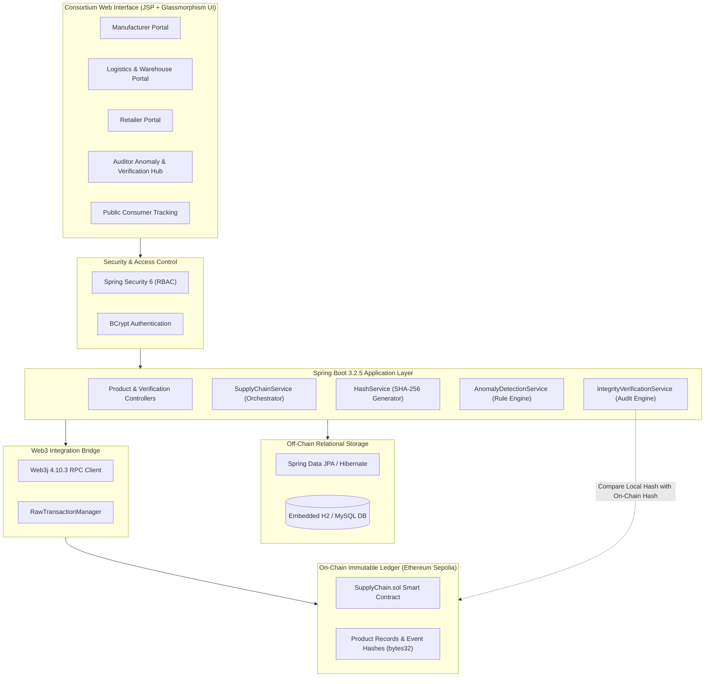

# 📄 Supply Chain Traceability System (SCT) - Comprehensive Technical Report

---

## 1. About the System

### 1.1 The "Why" (Problem Statement & Purpose)
Modern supply chains are fragmented, complex, and prone to several vulnerabilities:
- **Counterfeiting & Fraud**: Illicit substitution of pharmaceuticals, luxury goods, and electronics during storage and transit.
- **Data Tampering & Silos**: Traditional centralized databases (ERP/SQL) can be altered retroactively by unauthorized parties or corrupted insiders without leaving an immutable audit trail.
- **Cold-Chain Vulnerability**: Perishable items (vaccines, biologics, dairy, fresh foods) spoil when temperatures exceed regulatory thresholds, often detected only after reaching consumers.
- **Lack of Public Verification**: Consumers and regulatory bodies lack an instant, transparent mechanism to verify product provenance without relying solely on printed packaging labels.

The **Supply Chain Traceability (SCT) System** was designed to solve these challenges by creating an immutable, cryptographically verifiable, and role-governed supply chain network.

---

### 1.2 The "What" (System Definition)
The **SCT System** is a **Hybrid On-Chain / Off-Chain Enterprise Application** built with Java Spring Boot and Ethereum smart contracts. 
- It logs every checkpoint in a product's lifecycle—from raw material manufacturing to end-consumer sale.
- Every state transition generates a deterministic **SHA-256 cryptographic digest** anchored directly to the **Ethereum Sepolia Blockchain**.
- It incorporates an automated **Anomaly Detection Engine** that monitors environmental parameters (temperature, humidity) and logistics logic (travel speed, stage ordering) in real time.

---

### 1.3 The "How" (Operational Mechanism)
The system operates on a dual-tier hybrid model:
1. **High-Performance Off-Chain Storage**: Rich product metadata (descriptions, batch sizes, timestamps, GPS locations, environmental sensor telemetry) is stored in a relational database (H2/MySQL) for fast retrieval and searchability.
2. **Deterministic Cryptographic Hashing**: For each event, a canonical SHA-256 hash is computed using:
   $$\text{Hash} = \text{SHA-256}(\text{ProductId} + \text{Stage} + \text{Timestamp} + \text{Location} + \text{Temperature} + \text{ActorWallet})$$
3. **Immutable Blockchain Anchoring**: The 32-byte hash and stage identifier are committed on-chain via Web3j to the `SupplyChain.sol` smart contract on Ethereum Sepolia.
4. **Zero-Trust Integrity Verification**: Auditors and consumers can verify off-chain database rows against the smart contract bit-for-bit. If any database record is altered, the hash recomputation produces a mismatch, immediately flagging a `TAMPERED` status.

---

### 1.4 The "For Who" (Stakeholders & Target Audience)
The system is tailored for a multi-tier consortium:
- **Manufacturers**: Mint new product batches and declare cold-chain temperature tolerances.
- **Distributors & Logistics**: Record transit legs, handover events, and vehicle telemetry.
- **Warehouse Operators**: Record storage conditions and storage bay check-ins.
- **Retailers**: Mark arrival at retail stores and log the point of sale.
- **Compliance Auditors**: Inspect system anomalies, review temperature breaches, and run cryptographic verification audits.
- **End Consumers**: Access open, unauthenticated public tracking to verify provenance and authenticity before purchasing.

---

## 2. System Architecture & Directory Structure

### 2.1 High-Level Architecture Diagram



---

### 2.2 System Directory Tree

```
supply-chain-traceability/
├── .gitignore
├── application-local.properties
├── pom.xml
├── README.md
├── SCT_Report.md
├── start.bat
├── src/
│   └── main/
│       ├── java/
│       │   └── com/
│       │       └── supplychain/
│       │           └── app/
│       │               ├── SupplyChainApplication.java
│       │               ├── bean/
│       │               │   ├── ProductRegistrationBean.java
│       │               │   ├── StageUpdateBean.java
│       │               │   └── VerificationResultBean.java
│       │               ├── blockchain/
│       │               │   ├── BlockchainService.java
│       │               │   └── Web3jConfig.java
│       │               ├── config/
│       │               │   ├── DataSeeder.java
│       │               │   └── SecurityConfig.java
│       │               ├── controller/
│       │               │   ├── DashboardController.java
│       │               │   ├── ProductController.java
│       │               │   └── VerificationController.java
│       │               ├── entity/
│       │               │   ├── AnomalyLog.java
│       │               │   ├── Product.java
│       │               │   ├── SupplyChainEvent.java
│       │               │   └── User.java
│       │               ├── repository/
│       │               │   ├── AnomalyLogRepository.java
│       │               │   ├── ProductRepository.java
│       │               │   ├── SupplyChainEventRepository.java
│       │               │   └── UserRepository.java
│       │               └── service/
│       │                   ├── AnomalyDetectionService.java
│       │                   ├── HashService.java
│       │                   ├── IntegrityVerificationService.java
│       │                   └── SupplyChainService.java
│       ├── resources/
│       │   ├── application.properties
│       │   └── contracts/
│       │       └── SupplyChain.sol
│       └── webapp/
│           └── WEB-INF/
│               └── jsp/
│                   ├── anomalies.jsp
│                   ├── dashboard.jsp
│                   ├── login.jsp
│                   ├── product-list.jsp
│                   ├── register-product.jsp
│                   ├── track-product.jsp
│                   ├── update-stage.jsp
│                   └── verify.jsp
```

---

## 3. Detailed File Breakdown (Every File and What It Does)

### 3.1 Root & Configuration Files
- **`pom.xml`**: Maven Project Object Model. Defines Java 21, Spring Boot Starter Parent (3.2.5), Web3j dependencies, JPA, Tomcat Jasper embed engine, JSTL, H2, and MySQL connectors.
- **`start.bat`**: Windows automation batch script that opens a terminal window, navigates to the project directory, and executes `mvn spring-boot:run` with error handling.
- **`.gitignore`**: Excludes build artifacts (`target/`), compiled `.class` files, temporary log outputs, database files (`data/`), IDE metadata (`.idea/`, `.vscode/`), and local secret files.
- **`README.md`**: Project documentation providing quick-start steps, system credentials, architecture diagrams, and endpoint listings.
- **`application-local.properties`**: Private configuration file storing live Ethereum node RPC URLs, contract addresses, and wallet private keys. Ignored by Git for security.
- **`src/main/resources/application.properties`**: Core Spring application configuration. Configures server port (`9090`), JSP view resolver paths, H2 in-memory database URL, Hibernate DDL auto settings, Web3j gas settings, and fallback environment variables.

---

### 3.2 Smart Contract (`src/main/resources/contracts/`)
- **`SupplyChain.sol`**: Solidity 0.8.20 smart contract deployed on the Ethereum Sepolia network.
  - Maintains `products` mapping and a chronological `productHistory` array.
  - Implements `registerProduct(...)` to log batch creation.
  - Implements `addStageEvent(...)` to record immutable stage progressions with cryptographic `bytes32` hashes.
  - Provides `getLatestDataHash(...)` and `getEvent(...)` view methods for integrity checking.

---

### 3.3 Application Entry Point & Data Transfer Objects (`bean/`)
- **`SupplyChainApplication.java`**: Main Spring Boot entry point containing the `@SpringBootApplication` class and bootstrap `main(...)` method.
- **`ProductRegistrationBean.java`**: Form-backing bean validating incoming HTTP requests for new product registration (name, batch number, category, manufacturer, origin, and cold-chain constraints).
- **`StageUpdateBean.java`**: DTO validating lifecycle progression inputs (product ID, target stage, location, temperature, humidity, and notes).
- **`VerificationResultBean.java`**: View-model bean delivering audit outcomes to the UI, including verification status (`VERIFIED`, `TAMPERED`, `NO_ON_CHAIN_DATA`), event counts, and explanation messages.

---

### 3.4 Blockchain Bridge (`blockchain/`)
- **`Web3jConfig.java`**: Spring configuration class that initializes the Web3j HTTP client (`HttpService`), loads wallet `Credentials` from private keys, and configures static gas providers (`ContractGasProvider`).
- **`BlockchainService.java`**: Service layer handling low-level Ethereum operations:
  - Encodes Solidity function signatures (`FunctionEncoder`).
  - Manages nonce and transaction signing via `RawTransactionManager`.
  - Executes read calls via `ethCall` for `getLatestDataHash`.
  - Converts hex strings to 32-byte arrays (`hexStringToBytes32`) and handles block number checks.

---

### 3.5 Security & Data Seeding (`config/`)
- **`SecurityConfig.java`**: Configures Spring Security 6.
  - Declares Role-Based Access Control (RBAC) rules.
  - Whitelists public paths (`/login`, `/track`, static assets, H2 console, JSP forwards).
  - Enforces role requirements (e.g., `/product/register` requires `MANUFACTURER`).
  - Implements custom `UserDetailsService` loading credentials from the database and uses `BCryptPasswordEncoder`.
- **`DataSeeder.java`**: Implements `CommandLineRunner` to automatically seed the database on the first run with 6 pre-configured consortium accounts across all roles.

---

### 3.6 Controllers (`controller/`)
- **`DashboardController.java`**: Serves the root redirect (`/` $\rightarrow$ `/dashboard`), login page (`/login`), and aggregates KPI metrics (product counts, transaction event totals, unresolved anomalies) on `/dashboard`.
- **`ProductController.java`**: Manages product operations:
  - `GET/POST /product/register`: Product batch creation.
  - `GET/POST /product/update-stage`: Stage transitions with role validation.
  - `GET /product/list`: Searchable catalog of consortium products.
  - `GET /product/track`: Redirects to chronological history tracking.
- **`VerificationController.java`**: Handles verification and auditing:
  - `GET /track`: Public tracking page showing interactive timelines, actor details, telemetry, and Etherscan transaction links.
  - `GET /verify`: Cryptographic verification comparing database records with on-chain Ethereum state.
  - `GET /anomalies`: Anomaly management console for compliance officers.
  - `POST /anomalies/resolve/{id}`: Marks flagged anomalies as reviewed/resolved.

---

### 3.7 Database Entities (`entity/`)
- **`Product.java`**: JPA entity mapping the `products` table. Stores product UUID, batch number, name, category, manufacturer name, wallet address, cold-chain temperature thresholds, current stage, and blockchain transaction hash. Includes formatted timestamp helpers.
- **`SupplyChainEvent.java`**: JPA entity mapping `supply_chain_events`. Stores individual checkpoint records: stage name, geographical location, actor identity, environmental telemetry (temperature, humidity), notes, SHA-256 data hash, and Ethereum transaction hash.
- **`AnomalyLog.java`**: JPA entity mapping `anomaly_logs`. Stores automated rule violations: anomaly type (`TEMP_EXCURSION`, `OUT_OF_SEQUENCE`, `IMPOSSIBLE_SPEED`, `UNAUTHORIZED_ACTOR`), severity level (`LOW`, `MEDIUM`, `HIGH`, `CRITICAL`), description, timestamp, and resolution state.
- **`User.java`**: JPA entity mapping `users`. Stores username, BCrypt-hashed password, full name, wallet address, role enum (`MANUFACTURER`, `DISTRIBUTOR`, `WAREHOUSE`, `RETAILER`, `AUDITOR`, `CONSUMER`), and account status.

---

### 3.8 Database Repositories (`repository/`)
- **`ProductRepository.java`**: Spring Data JPA repository for querying products by UUID and fetching sorted catalog listings.
- **`SupplyChainEventRepository.java`**: Queries chronological events for specific products and finds the latest event for delta calculations.
- **`AnomalyLogRepository.java`**: Queries active unresolved anomalies, counts critical incidents, and fetches incident histories.
- **`UserRepository.java`**: Queries user records by unique username for authentication.

---

### 3.9 Business Logic Services (`service/`)
- **`SupplyChainService.java`**: Primary coordinator. Combines off-chain database persistence with on-chain Ethereum execution. Dispatches events to the hash service, saves entities, invokes anomaly checks, and commits transactions.
- **`HashService.java`**: Computes canonical, deterministic SHA-256 digests across event fields using Java `MessageDigest`. Ensures even a single character change in location, temperature, or actor produces a completely different hash.
- **`IntegrityVerificationService.java`**: Re-computes the SHA-256 hash from the local database record and compares it with `getLatestDataHash` retrieved from the Ethereum contract. Returns `VERIFIED` or `TAMPERED`.
- **`AnomalyDetectionService.java`**: Automated heuristic verification engine:
  - **Temperature Check**: Flags `TEMP_EXCURSION` if sensor reading is outside $[T_{\min}, T_{\max}]$.
  - **Sequence Check**: Flags `OUT_OF_SEQUENCE` if stages skip forward or regress backward.
  - **Velocity Check**: Flags `IMPOSSIBLE_SPEED` if checkpoint transit implies travel speeds $> 120\text{ km/h}$.
  - **Actor Authorization**: Verifies actor role against permitted transition rules.

---

### 3.10 Frontend Views (`src/main/webapp/WEB-INF/jsp/`)
- **`login.jsp`**: Glassmorphic dark login card with credentials reference and feedback banners.
- **`dashboard.jsp`**: Consortium control center showing KPI cards, real-time alert counters, recent anomalies, and recently registered products.
- **`register-product.jsp`**: Registration form with dynamic JavaScript toggles for cold-chain temperature boundary inputs.
- **`update-stage.jsp`**: Handover checkpoint logging form with stage selectors and environmental sensor input fields.
- **`product-list.jsp`**: Consortium product catalog displaying batch chips, cold-chain status badges, and quick-action buttons.
- **`track-product.jsp`**: Public chronological timeline with interactive status dots, event cards, environmental sensor readouts, SHA-256 hashes, and Sepolia Etherscan transaction links.
- **`verify.jsp`**: Cryptographic audit screen rendering verification badges (`VERIFIED`, `TAMPERED`, `PENDING`) and breakdown statistics.
- **`anomalies.jsp`**: Incident management console with severity badges (`CRITICAL`, `HIGH`, `MEDIUM`) and one-click incident resolution.

---

## 4. Software Stack & Versions Used

| Component / Layer | Technology | Version | Purpose |
| :--- | :--- | :--- | :--- |
| **Language Runtime** | Java Development Kit (JDK) | **21 LTS** (tested on 25) | Core execution platform |
| **Backend Framework** | Spring Boot | **3.2.5** | Microservice framework, dependency injection, auto-configuration |
| **Security Framework** | Spring Security | **6.2.4** | Role-Based Access Control, session management, password hashing |
| **Persistence / ORM** | Spring Data JPA / Hibernate | **6.4.4.Final** | Object-Relational Mapping and database abstraction |
| **Blockchain Client SDK** | Web3j Core | **4.10.3** | Ethereum JSON-RPC client, smart contract ABI wrappers, transaction signing |
| **Smart Contract Language** | Solidity | **0.8.20** | Immutable on-chain supply chain logic |
| **Blockchain Network** | Ethereum Sepolia Testnet | **Chain ID: 11155111** | Public decentralized test network |
| **Web3 Node Providers** | Infura / Alchemy | **JSON-RPC v3** | Ethereum blockchain gateway |
| **Embedded Web Server** | Apache Tomcat Embed | **10.1.20** | Servlet container |
| **JSP Compilation Engine** | Tomcat Embed Jasper | **10.1.20** | Runtime JSP parser and compiler |
| **Tag Library** | Jakarta Standard Tag Library (JSTL) | **3.0.0** (Glassfish 3.0.1) | Standard dynamic tags in JSP views |
| **Database (Primary)** | H2 In-Memory Database | **2.2.224** | Zero-setup, self-seeding relational storage |
| **Database (Alternative)**| MySQL Connector/J | **8.3.0** | Enterprise relational database driver (XAMPP compatible) |
| **Build & Dependency Tool**| Apache Maven | **3.8+ / 3.9+** | Build automation, packaging, and dependency management |
| **Development Environments**| Remix IDE & MetaMask | **Latest Web** | Smart contract compilation, deployment, and wallet key management |

---

## 5. Consortium Roles Walkthrough

All accounts are pre-seeded in [`DataSeeder.java`](file:///c:/Users/sathi/.gemini/antigravity/scratch/supply-chain-traceability/src/main/java/com/supplychain/app/config/DataSeeder.java).
**Master Password for all users**: `password123`

```
┌────────────────────────────────────────────────────────────────────────┐
│                        SUPPLY CHAIN LIFECYCLE                          │
│                                                                        │
│ [Manufacturer] ──> [Distributor] ──> [Warehouse] ──> [Retailer] ──> [Sold] │
│       │                   │                │              │            │
│       └───────────────────┴────────────────┴──────────────┴────────────┘
│                                   │
│           Auditor: Continuous Verification & Anomaly Review
│           Consumer: Public Provenance & Authenticity Check
└────────────────────────────────────────────────────────────────────────┘
```

---

### 5.1 Role: Manufacturer (`manufacturer1`)
- **Login**: Username `manufacturer1` | Password `password123`
- **Responsibilities**: Creates new product batches, sets cold-chain parameters, and mints the genesis transaction on Ethereum.
- **Walkthrough**:
  1. Log in and navigate to **`Register Product`** (`/product/register`).
  2. Input product details:
     - *Name*: `Covaxin Lot-X`
     - *Batch Number*: `BATCH-2026-V1`
     - *Category*: `Pharmaceutical`
     - *Manufacturer Name*: `Bharat Biotech Ltd.`
     - *Origin Location*: `Genome Valley, Hyderabad`
     - *Cold-Chain*: Check the box and set **Min Temp** = `2°C`, **Max Temp** = `8°C`.
  3. Click **`⛓ Register on Blockchain →`**.
  4. **System Response**:
     - Calculates initial SHA-256 hash.
     - Saves record into off-chain database.
     - Submits `registerProduct` transaction on Ethereum Sepolia.
     - Redirects to Dashboard with newly minted Product ID (e.g., `PROD-A1B2C3D4`).

---

### 5.2 Role: Distributor (`distributor1`)
- **Login**: Username `distributor1` | Password `password123`
- **Responsibilities**: Handles transportation and logistics, recording transit legs and vehicle telemetry.
- **Walkthrough**:
  1. Log in and click **`Update Stage`** (`/product/update-stage`).
  2. Enter the Product ID (e.g., `PROD-A1B2C3D4`).
  3. Select Stage: `IN_TRANSIT`.
  4. Fill transit telemetry:
     - *Location*: `Refrigerated Container 502, NH-44 Express`
     - *Temperature*: `4.2°C`
     - *Humidity*: `60%`
     - *Notes*: `Transit handover accepted from manufacturing depot.`
  5. Click **`Submit Stage Update`**.
  6. **System Response**: Computes new SHA-256 state hash, commits `addStageEvent` to Ethereum, and updates the timeline.

---

### 5.3 Role: Warehouse Operator (`warehouse1`)
- **Login**: Username `warehouse1` | Password `password123`
- **Responsibilities**: Verifies incoming consignments at storage depots and monitors warehouse environment.
- **Walkthrough**:
  1. Log in and go to **`Update Stage`**.
  2. Input Product ID $\rightarrow$ Select Stage: `WAREHOUSE_RECEIVED`.
  3. Enter telemetry:
     - *Location*: `Cold Bay C, Central Distribution Hub, Nagpur`
     - *Temperature*: `3.8°C`
     - *Humidity*: `50%`
     - *Notes*: `Tamper seals intact, temperature telemetry verified.`
  4. Click **`Submit Stage Update`**.
  5. *(Optional Simulation)*: Entering a temperature of `14°C` triggers an automated `TEMP_EXCURSION` anomaly logged for Auditors.

---

### 5.4 Role: Retailer (`retailer1`)
- **Login**: Username `retailer1` | Password `password123`
- **Responsibilities**: Manages physical store arrival and checkout to end consumers.
- **Walkthrough**:
  1. **Store Arrival**: Log in and update stage to `RETAIL_RECEIVED` at `Apollo Pharmacy Store #44, Chennai`.
  2. **Sale to Consumer**: When the unit is purchased, submit a stage update with `SOLD` at `Checkout Counter, Chennai`.
  3. **System Response**: Marks lifecycle as completed; prevents unauthorized regressions to earlier stages.

---

### 5.5 Role: Compliance Auditor (`auditor1`)
- **Login**: Username `auditor1` | Password `password123`
- **Responsibilities**: Audits database integrity against Ethereum, monitors anomalies, and reviews compliance breaches.
- **Walkthrough**:
  1. **Integrity Audit (`/verify`)**:
     - Navigate to **`Verify Product`**.
     - Enter Product ID and click **`🔐 Verify Now`**.
     - The system fetches the off-chain SHA-256 hash and compares it with `getLatestDataHash` from Ethereum.
     - Displays **`✓ INTEGRITY VERIFIED`** in green when hashes match, or **`⚠ INTEGRITY BREACH`** in red if any field has been modified in the database.
  2. **Anomaly Center (`/anomalies`)**:
     - Click **`Anomalies`** in the navigation bar.
     - Review flagged events sorted by severity (`CRITICAL`, `HIGH`, `MEDIUM`).
     - Inspect details (e.g., temperature spikes, skipped stages).
     - Click **`✓ Resolve`** once corrective actions have been documented.

---

### 5.6 Role: End Consumer / Public Visitor (`consumer1` or Unauthenticated)
- **Access**: Open to the public at `http://localhost:9090/track` (no login required).
- **Responsibilities**: Verifies item authenticity, cold-chain compliance, and full provenance before purchase.
- **Walkthrough**:
  1. Access `/track` and enter the Product ID printed on the packaging QR code.
  2. Click **`Track →`**.
  3. Inspect the verified supply chain history:
     - Product specifications, manufacturer identity, and cold-chain temperature thresholds.
     - Interactive step-by-step timeline of all transit checkpoints.
     - Exact date, time, location, actor, and sensor readings for every handover.
     - Cryptographic SHA-256 hash for every checkpoint.
     - Direct clickable link to the **Ethereum Sepolia Etherscan** transaction receipt proving the event occurred on the blockchain.

